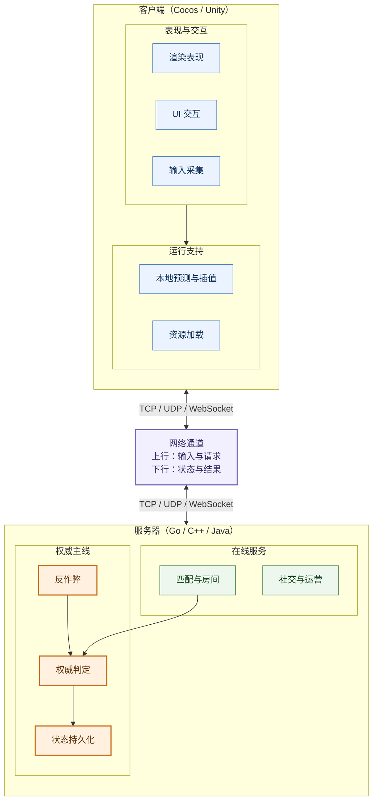

# 07 Architecture Overview

> This chapter systematically maps the core technical points of game servers, based on the classic framework of *Online Game Core Technologies and Practice* (Kenji Nakajima) and combined with modern game development practice.
>
> This piece records my understanding of the trade-offs in game server architecture: it focuses on the reasons behind design decisions and on how boundaries shift as a system grows from a single server to a distributed one. Concrete solutions still have to be judged against project scale, gameplay, and team conditions—you cannot treat a million concurrent players as a universal goal.

---

## 1. Why Do You Need a Client-Server Architecture?

### From Standalone to Online: An Inevitable Evolution

Early games were standalone—all logic ran on one machine. But when multiplayer games appeared, a fundamental question surfaced: **who has the final say?** If player A says "I hit you for 100 damage" and player B says "you never hit me at all," who is right?

The answer to this question is **server authority**: all critical adjudications are made by the server, and the client is just a "monitor" and an "input device". This architectural choice directly shapes every subsequent technical decision.

*Online Game Core Technologies and Practice* describes the client-server architecture as "the cornerstone of online gaming." The server does not merely forward messages; it is the **referee** of the entire game world—judging damage, validating movement, detecting cheating, and managing the economy.

### Dividing Responsibilities Between Client and Server



Server authority is the master principle of this division of responsibilities: critical adjudications and state belong to the server. The client handles presentation and input, and improves interaction feedback through local prediction and interpolation.

### Client Technology Choice: Cocos vs Unity

| Dimension | Cocos Creator | Unity |
|------|--------------|-------|
| **Language** | TypeScript | C# |
| **Web support** | Native | Requires WebGL |
| **2D games** | ⭐⭐⭐⭐⭐ | ⭐⭐⭐⭐ |
| **3D games** | ⭐⭐ | ⭐⭐⭐⭐⭐ |
| **Mini games** | ⭐⭐⭐⭐⭐ | ⭐⭐ |
| **Native mobile games** | ⭐⭐⭐ | ⭐⭐⭐⭐⭐ |
| **Learning curve** | Low | Medium |

**Selection advice**: if you are making a WeChat mini game or an H5 game, pick Cocos first; for native mobile games or 3D games, pick Unity first. Do not choose Unity just because "Unity is more famous"—technology selection should be based on requirements, not reputation.

### Why Do Many Games Use WebSocket Instead of Raw TCP?

WebSocket is a compromise: it runs in the browser with good compatibility, but performs worse than raw TCP. For mini games, H5 games, and web games, WebSocket is the common choice—you cannot make players install a native client. For native mobile games, TCP or UDP is the better choice, because you can fully control the network layer.

*Million Online* points out that the main problem with WebSocket is the **connection count ceiling**: a single server supports at most 10-20 thousand WebSocket connections, while raw TCP can support more than 100 thousand. If your game needs to support massive concurrency, WebSocket may become the bottleneck.

### Client-Server Communication Patterns

In games, client-server communication has two basic patterns:

**Request-response** (e.g. HTTP): the client sends a request, the server returns a result. Suitable for operations that do not need real-time performance—login, inventory queries, in-game shop purchases. The advantage is simplicity and reliability; the disadvantage is that the server cannot push messages proactively.

**Persistent-connection push** (e.g. TCP/WebSocket): the client and server keep a persistent connection, and either side can send messages at any time. Suitable for operations that need real-time performance—movement sync, combat broadcasts, chat messages. The advantage is low latency; the disadvantage is that connection state must be maintained.

Most games use both patterns at once: HTTP handles low-frequency operations such as login and payment, while TCP/WebSocket handles real-time game logic. This hybrid architecture guarantees reliability while meeting real-time requirements.

---

## 2. Communication Protocol Design: The Language of Online Gaming

### Protocol Layering: Why Can't You Just Send JSON?

Many beginners do exactly this: the client sends JSON, the server receives JSON, done. This is fine at the prototype stage, but after launch you run into a series of problems:

1. **Bandwidth waste**: `{"x":1.234567,"y":2.345678}` is 3-5x larger than a binary format
2. **Parsing overhead**: JSON parsing requires lots of memory allocation and string processing
3. **Type safety**: JSON has no type constraints; a wrongly written field produces no compile error
4. **Version compatibility**: adding a new field requires updating client and server at the same time

*Million Online* emphasizes that protocol design is the most fundamental and most easily neglected part of a game server. A good protocol design lets you extend server functionality without modifying the client.

```text
┌─────────────────────────────────────┐
│           应用层协议                 │
│   (游戏消息: 移动、攻击、聊天等)     │
├─────────────────────────────────────┤
│           会话层协议                 │
│   (登录、心跳、断线重连)             │
├─────────────────────────────────────┤
│           传输层协议                 │
│   (TCP/UDP/WebSocket)               │
├─────────────────────────────────────┤
│           网络层协议                 │
│   (IP/路由)                         │
└─────────────────────────────────────┘
```

### Message Format Choice: Protobuf vs FlatBuffers

| Feature | Protobuf | FlatBuffers |
|------|----------|-------------|
| **Serialization speed** | Fast | Extremely fast (zero-copy) |
| **Deserialization speed** | Fast | Extremely fast (direct access) |
| **Data size** | Small | Smaller |
| **Schema changes** | Backward compatible | Backward compatible |
| **Ecosystem** | Extremely mature | Maturing |
| **Use cases** | Most games | High-performance scenarios (FPS, MOBA) |

### Transport Layer Choice: TCP vs UDP vs KCP

| Transport | Reliability | Latency | Use cases | Implementation complexity |
|--------|--------|------|---------|-----------|
| **TCP** | ✓ | Medium | Most games | Low |
| **WebSocket** | ✓ | Medium | Web/mini games | Low |
| **UDP** | ✗ | Low | Real-time competitive | High |
| **KCP** | ✓ | Low | Mobile games | Medium |

**Core decision**: if your game does not need extremely low latency (e.g. card games, strategy), TCP/WebSocket is enough. Only latency-critical games such as FPS and MOBA need to consider UDP/KCP.

### Message Header Design: Balancing Simplicity and Extensibility

```go
// 常用的8字节消息头（约10行核心逻辑）
// [4字节长度][4字节消息ID]
func Encode(msgID uint32, payload []byte) []byte {
    buf := make([]byte, 8+len(payload))
    binary.BigEndian.PutUint32(buf[0:4], uint32(8+len(payload)))
    binary.BigEndian.PutUint32(buf[4:8], msgID)
    copy(buf[8:], payload)
    return buf
}
```

> **Pitfall: do not use variable-length headers**. Variable-length headers (e.g. send a 1-byte length first, then 2 bytes if that is not enough) complicate the parsing logic under high concurrency and easily cause sticky-packet/split-packet problems. A fixed-length header wastes a few bytes, but parsing is simple and performance is predictable.

---

## 3. Frame Sync vs State Sync: The Two Roads of Online Gaming

### The Essential Difference Between the Two Sync Models

Frame sync and state sync are the two major schools of game networking, and which one you choose directly shapes the entire architecture.

**Frame sync** (lockstep): the server collects all players' inputs and broadcasts them frame by frame to all clients. Each client computes the same result from the same inputs.

**State sync**: the server computes the game state and broadcasts state differences to the clients. Clients only need to "play back" the state changes.

### Comparative Analysis

| Feature | Frame sync | State sync |
|------|--------|----------|
| **Authority** | Client (determinism) | Server |
| **Bandwidth** | Low (inputs only) | High (states) |
| **Latency sensitivity** | Extremely high | Medium |
| **Replay** | Natively supported | Requires extra recording |
| **Anti-cheat** | Hard | Easy |
| **Representative games** | StarCraft, Honor of Kings | CS:GO, PUBG |

### When to Use Frame Sync?

- **MOBA/RTS**: need precise operation sync, e.g. *Honor of Kings*, *League of Legends*
- **Fighting games**: need frame-exact collision detection
- **Turn-based strategy**: simple operations, but deterministic results required

### Frame Sync Costs More to Build Than You Think

Frame sync looks simple—the server collects inputs and broadcasts them to all clients—but in actual development you hit a pile of thorny problems:

**Determinism problems**: floating-point arithmetic results can differ slightly across platforms (the IEEE 754 standard allows this). A floating-point difference of 0.0000001, accumulated over thousands of frames, can lead to completely different game outcomes. The solution is to replace floating-point numbers with fixed-point numbers, but that adds a lot of development work.

**Replay and spectating**: frame sync supports replay natively—just record all inputs and play them back. But "spectating" needs to support "jumping to any point in time," which requires periodically saving snapshots, adding storage and compute cost.

**Difficult anti-cheat**: because the client holds the complete game state, cheats can read memory to get enemy positions and auto-aim. The server only sees "inputs" and cannot tell whether an input comes from a human or a script. The solution is to run the logic once more on the server for verification, but that is almost double the computation.

**Network latency compensation**: player A acts under 50ms latency, player B under 20ms latency. If the server waits for all inputs before advancing a frame, the high-latency player feels "lag". The solution is "optimistic advancement"—do not wait for everyone's input; when the time comes, advance, and fill missing inputs with no-ops. But this introduces new fairness problems.

### When to Use State Sync?

- **FPS shooters**: need server-authoritative adjudication to prevent cheating
- **MMO**: many entities, complex state
- **Casual games**: not latency-sensitive, simple to develop

### Pitfall: Frame Sync's "Determinism" Is the Biggest Challenge

Frame sync requires all clients to produce exactly the same result for the same inputs. This means: floating-point arithmetic must be consistent across platforms, random numbers must use fixed seeds, and the physics engine must be deterministic. Any tiny difference causes a "desync"—the most painful problem of frame sync.

> **Advice from *Game Server Architecture and Optimization***: if you are not sure which one to pick, choose state sync. State sync has lower development cost, easier maintenance, and simpler anti-cheat. Frame sync is worth using only when "determinism" is a core requirement.

---

## 4. AOI (Area of Interest) Management: The Core MMO Problem

### Why Is AOI Needed?

Imagine an MMO with 100 thousand players online. If every player's movement were broadcast to everyone, network bandwidth would explode. But in reality, a player only cares about others "within 100 meters".

AOI (area of interest) solves exactly this problem: **only sync "nearby" information to each player**. This is the key to MMO performance—without AOI, you simply cannot support massive concurrency.

### The Nine-Grid Algorithm: The Most Common AOI Scheme

The idea of the nine-grid algorithm is simple: divide the game world into grids, and each player only receives information from its own grid and the 8 surrounding grids.

```go
// 九宫格 AOI 核心逻辑（约15行）
func (m *AOIManager) GetNearbyEntities(x, y float64, radius float64) []*Entity {
    gridX := int(x) / m.gridWidth
    gridY := int(y) / m.gridHeight

    var entities []*Entity
    for dx := -1; dx <= 1; dx++ {
        for dy := -1; dy <= 1; dy++ {
            key := (gridX+dx)*10000 + (gridY+dy)
            if grid, ok := m.grids[key]; ok {
                entities = append(entities, grid.Entities...)
            }
        }
    }
    return entities
}
```

### AOI Algorithm Selection

| Algorithm | Implementation complexity | Performance | Use cases |
|------|-----------|------|---------|
| Nine-grid | Low | High (O(1) query) | Most MMOs |
| Cross-linked list | Medium | Medium (O(log n)) | Needs precise range queries |
| Quadtree | High | High (dynamic partitioning) | Extremely uneven entity distribution |

### Pitfall: Choosing the AOI Grid Size

Grids too small → frequent cross-grid migration and broadcast storms; grids too large → every player sees too many irrelevant people and bandwidth is wasted. **Rule of thumb**: the grid side length should be 1/3 to 1/2 of the "player view radius". For example, with a 100-meter view, a 30-50 meter grid side length.

---

## 5. The Game Loop: The Server's Heartbeat

### Server Tick: Why Do Servers Also Need a "Frame Rate"?

Many people think servers do not need a "frame rate"—they just need to process requests and return results. But for real-time games (e.g. MMO, FPS), the server must **actively advance the game world**: NPC patrols, skill cooldowns, buff expiry, physics collisions—none of these can wait for a player message before being processed.

The "game loop" pattern from *Game Programming Patterns* applies equally on the server side: the server executes a round of logic updates at a fixed frequency (e.g. 20Hz), processing input, updating state, and syncing clients.

### Why Can't "Event-Driven" Replace "Fixed Tick"?

Many frameworks (e.g. Skynet, Pitaya) are event-driven—process messages when they arrive, idle otherwise. This is entirely adequate for card and turn-based games, but in real-time games it runs into problems:

**NPCs do not move on their own**: an event-driven server only works when a player sends a message. If no player acts within 10 seconds, NPCs stop patrolling, buffs stop expiring, the poison zone stops shrinking—the game world "freezes".

**Inaccurate skill cooldowns**: an event-driven server cannot keep time precisely. After a player casts a skill, the server needs to "it is worth noting," trigger the cooldown end 5 seconds later. A Tick-driven server simply checks once per Tick.

**Physics simulation needs a fixed step**: physics simulation such as collision detection and ballistic calculation depends on a fixed time step. An event-driven server has irregular time intervals, which makes physics simulation unstable.

**Conclusion**: for games where "the world keeps advancing" (MMO, FPS, MOBA), Tick-driven is required. For games that "advance only when the player acts" (card, turn-based, strategy), event-driven is simpler and more efficient.

### The Core Server Tick Flow

```text
┌─────────────────────────────────────┐
│            游戏主循环                │
├─────────────────────────────────────┤
│  1. 处理网络消息                     │
│  2. 处理玩家输入                     │
│  3. 执行游戏逻辑                     │
│  4. 更新物理状态                     │
│  5. 计算 AOI                        │
│  6. 同步状态给客户端                 │
│  7. 持久化数据                       │
│  8. 等待下一帧                       │
└─────────────────────────────────────┘
```

### Choosing the Tick Frequency

| Game type | Recommended tick frequency | Reason |
|---------|---------------|------|
| MMO | 10-20Hz | Balances performance and experience |
| FPS | 20-60Hz | Needs high-precision adjudication |
| MOBA | 15-30Hz | Frame sync needs a fairly high frequency |
| Card/turn-based | No tick needed | Event-driven suffices |
| SLG | 1-5Hz | Mostly offline calculation |

### Pitfall: Tick Overruns Cause "Slow Motion"

If a Tick should finish within 50ms (20Hz) but actually takes 100ms, the game world slows down—every action is delayed twofold. **Monitoring focus**: monitor Tick duration in real time and alert immediately once it exceeds the threshold.

```go
// Tick 耗时监控（约5行）
func (s *GameServer) tick() {
    startTime := time.Now()
    // ... 执行逻辑 ...
    duration := time.Since(startTime)
    if duration > s.tickDuration {
        log.Warn("tick耗时超标", "duration", duration)
    }
}
```

---

## 6. Timer Management: The Game World's Clock

### Why Are Timers Needed?

The game world is full of "waiting": a 5-second skill cooldown, a 30-second buff, a 2-hour building upgrade, a daily reset at 5 a.m. All of these need timers to drive them.

### Comparing Timer Implementation Schemes

| Scheme | Implementation complexity | Precision | Use cases |
|------|-----------|------|---------|
| Traversal timers | Low | Low | Few timers (<1000) |
| Timing wheel | Medium | High | Many timers (>10000) |
| Min-heap | Medium | High | High precision requirements |
| Timing wheel + min-heap | High | Extremely high | Large MMOs |

### Core Code Example: A Simple Timer

```go
// 简单定时器管理（约15行）
type TimerManager struct {
    timers map[int64]*Timer
    nextID int64
}

func (m *TimerManager) AddTimer(interval time.Duration, repeat bool, cb func()) int64 {
    m.nextID++
    m.timers[m.nextID] = &Timer{
        ID: m.nextID, Interval: interval, Repeat: repeat, Callback: cb,
    }
    return m.nextID
}

func (m *TimerManager) Update(now time.Time) {
    for _, timer := range m.timers {
        if now.Sub(timer.lastFire) >= timer.Interval {
            timer.Callback()
            timer.lastFire = now
        }
    }
}
```

### Pitfall: Do Not Do Heavy Work in Timer Callbacks

Timer callbacks execute inside the Tick. If a callback takes too long (e.g. querying the database, making HTTP requests), it blocks the whole Tick and every player stutters. **Recommended practice**: put heavy operations into an async queue and let the timer do nothing but "fire".

---

## 7. Player Management: Login, Sessions, and Reconnection

### The Login Flow: More Than "Verifying a Password"

A complete login flow involves multiple steps: verify identity → load data → assign a server → establish a session. Every step can fail, so you need a sensible fault tolerance design.

```text
客户端                LoginServer              GameServer              DBServer
  │                      │                      │                      │
  │──── 登录请求 ────────→│                      │                      │
  │                      │──── 验证Token ───────→│                      │
  │                      │                      │──── 查询玩家 ────────→│
  │                      │                      │←──── 玩家数据 ────────│
  │                      │←──── 登录成功 ───────│                      │
  │←──── 返回Token ──────│                      │                      │
  │                      │                      │                      │
  │──── 进入游戏 ───────────────────────────────→│                      │
```

### Reconnection: Key to the Player Experience

Network instability is the norm. A good reconnection mechanism can greatly improve the player experience:

1. **Keep the session**: after a disconnect, the server retains the player's state for a period (e.g. 5 minutes)
2. **Cache messages**: messages during the disconnection are cached on the server and resent after reconnection
3. **Seamless recovery**: after reconnecting, the player returns to the pre-disconnect state instead of "vanishing into thin air"

```go
// 断线重连核心逻辑（约20行）
func (m *ReconnectManager) OnReconnect(playerID uint64, conn net.Conn) (*Session, error) {
    session, ok := m.sessions[playerID]
    if !ok {
        return nil, errors.New("会话不存在")
    }

    // 检查是否超时
    if time.Since(session.DisconnectTime) > m.timeout {
        delete(m.sessions, playerID)
        return nil, errors.New("重连超时")
    }

    // 恢复会话，补发缓存消息
    session.IsOnline = true
    session.Conn = conn
    for _, msg := range m.pendingData[playerID] {
        conn.Write(msg.Encode())
    }
    return session, nil
}
```

### Pitfall: Choosing the Session Timeout

Too short → players who switch apps come back to a dropped session, a terrible experience; too long → the server must keep memory for a large number of "already disconnected" players, wasting resources. **Rule of thumb**: mobile games 3-5 minutes, PC games 5-10 minutes, web games 1-3 minutes.

---

## 8. Data Persistence: Player Data Must Not Be Lost

### Data Tiering: Hot vs Warm vs Cold Data

Game data has different access frequencies and life cycles and should use different storage schemes:

```text
┌─────────────────────────────────────┐
│           热数据（Redis）            │
│   在线状态、实时数据、缓存           │
├─────────────────────────────────────┤
│           温数据（MySQL）            │
│   玩家档案、背包、装备               │
├─────────────────────────────────────┤
│           冷数据（归档）             │
│   历史记录、日志、统计               │
└─────────────────────────────────────┘
```

### Caching Strategy: The Cache-Aside Pattern

The most common caching strategy is **Cache-Aside** (bypass cache): on reads, query the cache first and fall back to the database on a miss; on writes, update the database first, then invalidate the cache.

```go
// Cache-Aside 核心逻辑（约15行）
func GetPlayer(playerID uint64) (*Player, error) {
    // 1. 先查 Redis
    cacheKey := fmt.Sprintf("player:%d", playerID)
    data, err := redis.Get(ctx, cacheKey).Bytes()
    if err == nil {
        var player Player
        json.Unmarshal(data, &player)
        return &player, nil
    }

    // 2. 查 MySQL
    var player Player
    db.Where("id = ?", playerID).First(&player)

    // 3. 写入 Redis（设置过期时间）
    data, _ = json.Marshal(player)
    redis.Set(ctx, cacheKey, data, 30*time.Minute)
    return &player, nil
}
```

### Cache Penetration / Breakdown / Avalanche

These three are classic cache system problems; if you do not understand them, you will step in the pit sooner or later:

| Problem | Symptom | Cause | Solution |
|------|------|------|---------|
| **Penetration** | Queries for nonexistent data hit the DB every time | Malicious requests or data deletion | Bloom filter + null-value caching |
| **Breakdown** | A hot key expires and many requests hit the DB at once | Concurrent cache rebuild | Distributed lock; let only one request query the DB |
| **Avalanche** | Many keys expire at once and the DB is crushed | Expiration times too concentrated | Add random jitter to expiration times |

---

## 9. Security and Anti-Cheat: Guardians of Fair Play

### The Core Principle of Anti-Cheat

**Never trust the client**. Any data the client sends may be forged. The server must validate every critical operation.

### Common Cheat Types and Countermeasures

| Cheat type | Detection method | Handling |
|---------|---------|---------|
| Speed hacks | Timestamp validation, speed detection | Warning, account ban |
| Wallhacks | Server-side view control | Server adjudication |
| Bot scripts | Behavior pattern analysis (standard deviation detection) | CAPTCHA, account ban |
| Memory editing | Critical data validation | Data rollback |
| Protocol tampering | Signature verification | Disconnect |

### Core Code Example: Movement Speed Validation

```go
// 移动速度校验（约10行）
func ValidateMove(player *Player, move MoveRequest) error {
    distance := player.Position.DistanceTo(move.Position)
    if distance > MaxMoveDistance {
        return ErrMoveTooFar
    }

    speed := distance / time.Since(player.LastMoveTime).Seconds()
    if speed > MaxMoveSpeed {
        return ErrMoveTooFast
    }
    return nil
}
```

### Pitfall: Anti-Cheat Should Not Be "One-Size-Fits-All"

Banning immediately upon detecting an anomaly is the wrong approach. Many "anomalies" are actually caused by network latency or poor device performance. **Recommended practice**: build a trust score mechanism where punishment triggers only after repeated anomalies. First offense a warning, second offense a kick, third offense a ban.

---

## 10. Cross-Server and Server Merge: The Inevitable Road of Game Operations

### Why Cross-Server?

When a single server's online population reaches its cap (e.g. 5000 players), new players cannot get in. At that point you open a new server. But players on the new server complain "too few people, not fun," while players on the old server complain "matchmaking never finds anyone". Cross-server systems (cross-server matchmaking, cross-server guild wars, cross-server leaderboards) solve this problem.

### Why Server Merge?

After operating for a while, some servers' online population drops very low (e.g. 500 players). Players on these "ghost servers" have a terrible experience—no one to chat with, matchmaking never finds anyone, guild wars cannot fill ranks. A server merge can combine several low-population servers into one high-population server.

### The Core Challenges of Server Merge

1. **Duplicate names**: both servers have a "Player1"—what happens after the merge? Usually a server suffix is added (e.g. "Player1_S1")
2. **Guild merges**: both servers have a "Strongest Guild"—only one can remain after the merge
3. **Leaderboard rebuild**: rankings must be recomputed after the merge
4. **Data consistency**: ensure no data is lost or duplicated during migration

### Pitfall: Design Server-Merge Compensation in Advance

A server merge affects every player's experience (renames, leaderboard shifts, guild reorganization). **The compensation plan must be designed in advance**: hand out rename cards, diamond compensation, special titles. A server merge without compensation drives away a large share of players.

---

## 11. Performance Optimization: Making the Server Run Faster

### Performance Metric Reference

| Metric | Target | Notes |
|------|--------|------|
| Response time | < 100ms | P99 latency |
| Throughput | > 10000 QPS | Requests per second |
| Online players | > 5000 | Per-server capacity |
| CPU usage | < 70% | Peak |
| Memory usage | < 80% | Peak |

### Core Principles of Performance Optimization

1. **Measure first, then optimize**: do not optimize by gut feeling; let the data speak
2. **Reduce memory allocation**: object-pool reuse, preallocated buffers
3. **Batch processing**: merge many small operations into one big operation
4. **Async**: move heavy operations into an async queue
5. **Cache hot data**: cache frequently accessed data in Redis

### Core Code Example: Object Pool Reuse

```go
// 对象池复用消息对象（约10行）
var msgPool = sync.Pool{
    New: func() interface{} {
        return &GameMessage{Payload: make([]byte, 0, 256)}
    },
}

func GetMessage() *GameMessage {
    return msgPool.Get().(*GameMessage)
}

func PutMessage(msg *GameMessage) {
    msg.Reset()
    msgPool.Put(msg)
}
```

---

## 12. Operations and Deployment: Keeping the Server Stable

### Docker Deployment

```dockerfile
# 简化的 Dockerfile（约5行）
FROM golang:1.21-alpine AS builder
WORKDIR /app
COPY . .
RUN go build -o server .

FROM alpine:latest
COPY --from=builder /app/server .
CMD ["./server"]
```

### Monitoring and Alerting

Core metrics a game server needs to monitor:

| Metric | Alert threshold | Notes |
|------|---------|------|
| Online players | > 5000 | Per-server capacity warning |
| Error rate | > 10% | System anomaly |
| P99 latency | > 500ms | Player experience degrades |
| Memory usage | > 80% | Possible OOM |
| Tick duration | > tickDuration | Game slows down |

---

## 13. Practical Case: A Frame-Sync Determinism Investigation Into "Different HP on the Same Screen"

> This case is a demonstration example (not taken from a real project); numbers are rounded and simplified. It takes Section 3's determinism warning, Section 5's tick frequency selection, and Section 6's timer scheme comparison into deep water: answering, frame by frame, "the same input—why did two devices compute two different HP bars". This is a frame-sync determinism investigation, and a full expansion of "Pitfall: frame sync's 'determinism' is the biggest challenge".

**Background and symptoms**: a self-developed MOBA (frame sync + lockstep) had a new version live for one week and collected **57** player tickets saying "same strike, two phones lose HP differently"—in the same match, device A crits while device B normal-attacks, and screenshots tear the official community group apart. More counterintuitively: official replays, re-run match by match, showed all **200** disputed matches "reproducing normally"; a recheck with cross-device state-hash reconciliation found **23** matches whose hash diverged after a certain frame (**11.5%**), of which **19** came from v2.3.0 (**83%**)—the replay says nothing is wrong, the reconciliation says something is; align the measurement criteria first.

### Step 1: Symptoms and Criteria—The "Reproduces Normally" Criterion Is Itself the Blind Spot

The divergence criterion was unified as: same version, same seed, replay the same input sequence until the state hashes disagree. Line up the three criteria:

- **Server-side replay**: **0** of **200** matches error—the server is a single machine; replaying against itself is always self-consistent
- **Cross-device hash reconciliation**: both ends run once each and compare state hashes frame by frame—**23** matches diverge, all stably reproducible
- The **criteria gap** is exactly those **23** matches: server replay measures "the logic did not crash"; only cross-device reconciliation measures "determinism"—the architecture version of Chapter 13's "all-green monitoring": when the criterion is wrong, all-green metrics are useless

The investigation started by cutting into the determinism checklist: floating point (fixed-point refactor), random (fixed seed), physics (version lock)—all three have dedicated workstreams, but the thing not on the checklist is precisely this case's culprit.

### Step 2: Layered Attribution—Elimination on the Determinism Checklist

Cross-referencing Section 5: of the Tick main loop's **8** steps, steps 3 and 4 (game logic, timers) are the suspect zone; among the frequency table's **5** game types, the MOBA tier is **15**~**30**Hz and the project uses **20Hz** (frame length **50ms**). The ledger:

```text
随机数   对局种子随开局下发，19 场分叉局种子一致——排除
数值     定点数改造 v2.1 已全量，分叉无平台聚集（iOS 8 / Android 11）——排除
输入     分叉帧输入序列逐帧比对完全一致（顺序性由第 04 篇 2.3 的排序窗口保障）——排除
帧号     19 场分叉点全部落在 buff 到期帧或冷却结束帧 ±1 帧内——聚集
定时器   v2.3.0 把 buff/冷却到期从「逻辑帧计数」改为「时间轮 + 系统时钟」——唯一嫌疑
补帧     锁步追帧一次补 6 帧（抖动 300ms / 50ms = 6），补帧期间墙钟只前进 50ms
```

The ledger converges: all **19** divergences fall near an expiry frame (within ±**1** frame); platform split iOS **8** / Android **11** (no clustering); catch-up jitter **300ms** / frame **50ms** = **6** frames to backfill; and the only logic change in v2.3.0 swapped expiry adjudication from frame counting to the system clock.

### Step 3: Root Cause—Time Went From "Measurement" to "Input"

1. **Direct cause**: a buff lasting **5 seconds** (i.e. **100** frames at **20Hz**) has its expiry judged by the wall clock during lockstep frame catch-up—backfilling 6 frames advances the wall clock only 50ms, so the expiry frame number drifts with each device's real-time catch-up rhythm; with the same input sequence, different devices invalidate the buff at different logical frames, and a single strike's settlement naturally produces two different HP bars
2. **Mechanism cause**: determinism's hidden input. Section 3 names the floating point/random/physics trio, while the system clock is the fourth variable that never made the checklist—v2.3.0 replaced traversal timers with a timing wheel (the higher-precision one among the **4** schemes in Section 6's scheme table), which is right on performance and wrong on semantics: under lockstep the wall clock is not a measurement, it is an input that participates in the computation
3. **Deeper cause**: the replay gate records in a zero-jitter environment and replays with zero jitter—the frame catch-up path is never executed, so "reproduces normally" is inevitable; Tick duration monitoring (Section 5's "Pitfall: slow motion") watches fast vs slow, not consistency—the missing metric is not on the dashboard; it is in the criteria

### Step 4: Remediation and Backfill

Remediation ordered by "benefit / cost":

1. Expiry adjudication returns to logical frame counting (trigger frame + **100** frames); the timing wheel only schedules, never measures: a retest of the 23 matches shows **0** divergences
2. The replay gate injects jitter of **100~500ms** (i.e. **2~10** backfilled frames) and replays recordings under the worst network
3. Cross-device state-hash reconciliation enters monitoring percentiles (Chapter 13's criteria): divergence rate **11.5%** → **0%**
4. The determinism checklist expands into a quartet: floating point, random, physics, time

**Recheck**: one week after release, **0** tickets with the same cause (**57** in the two weeks before); the replay gate ran the full hero-combo library clean, and the cross-device hash divergence rate is zero.

**Backfill checklist** (echoing Chapter 14's retrospective backfill discipline):

| Backfill item | Owner | Completion criteria |
|--------|------|---------|
| Add "time" to the determinism checklist as the fourth variable and bring it into frame-sync module review (isomorphic to Chapter 19's budget lesson: the variable missing from the checklist is exactly the variable that will drift) | Server/client | Checklist review passed |
| Replay gate: worst-case network injection + cross-device hash comparison into version acceptance (echoing Chapter 20's acceptance gates) | QA/client | Gate wired into the pipeline |
| Cross-device hash divergence rate onto the dashboard by percentile (echoing Chapter 13's criteria lesson) | Server/data | Dashboard live |
| Lockstep projects adopt determinism self-checks: reconcile floating point/random/physics/time item by item | Client | All matches run through cleanly |

### Three Lessons from the Case

1. **In frame sync, time is not a measurement; it is an input**. Beyond Section 3's determinism trio, the wall clock is the fourth variable that will drift—lockstep frame catch-up amplifies it into settlement differences
2. **A replay that reproduces normally ≠ no divergence**. The recording environment's zero jitter left the frame catch-up path never executed—the more ideal the test environment, the more you must replay under the worst conditions
3. **The criteria themselves can go all green**. Server replay with 0 errors and tick duration within target—neither criterion lied; what lied was the assumption that "this layer of criteria represents determinism" (the architecture version of Chapter 13's all-green monitoring)

---

## Summary

| Key concept | Key points |
|---------|---------|
| Client-server | Server authority; the client is a display |
| Protocol design | Protobuf + fixed-length header |
| Frame sync vs state sync | When unsure, choose state sync |
| AOI | The nine-grid is the most common scheme |
| Game loop | MMOs need a 10-20Hz tick |
| Caching strategy | Cache-Aside; guard against penetration/breakdown/avalanche |
| Anti-cheat | Never trust the client; build trust scores |
| Cross-server and server merge | Design the compensation plan in advance |

> **Final advice**: *Game Server Architecture and Optimization* tells us that good architecture is never built in one step; it evolves incrementally. Start from the simplest HTTP server and introduce more complex solutions only when concrete problems appear. **Do not over-engineer, but do not skip design entirely either**.

## References

- [Wikipedia · Game programming](https://en.wikipedia.org/wiki/Game_programming)
- [Wikipedia · Video game engine](https://en.wikipedia.org/wiki/Video_game_engine)

<!-- BACKLINKS-AUTO -->
## Related Pages

- [knowledge](/knowledge.md)
- [01-authoritative-books](/research/01-authoritative-books.md)
