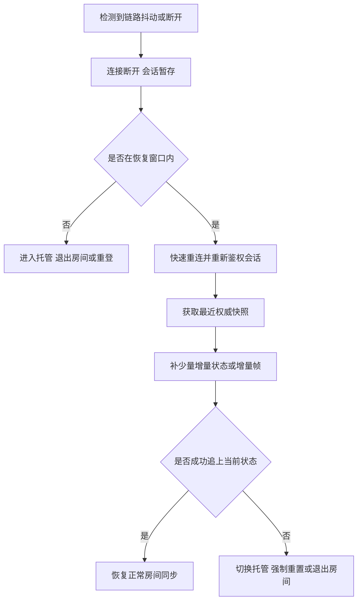

# Room Broadcast, Weak Networks, and the Domestic Network Environment

## Category

networking / weak-network governance. Node position: design room broadcast back inside the real conditions of domestic mobile networks.

## Definition


Abstract networking discussions that are not returned to a real environment easily stay stuck on ideal conditions. For many mobile-facing, room-based games operating in the domestic network environment, the real challenge is not average RTT in the lab, but weak networks, network switching, base-station fluctuation, background-to-foreground, regional link differences, and room broadcast being held up by a handful of slow connections.

This page cares about: when a match has multiple players sharing state and each person's network quality is constantly fluctuating, how can the system keep the match playable without letting the whole room's experience be held hostage by the worst link.


### Why room broadcast amplifies network problems

Room-based scenarios differ from ordinary peer-to-peer interaction in that they naturally carry two amplifiers:

- One player going abnormal affects the whole room's experience.
- The same state change may have to be broadcast to many people.

So when one player is on a weak network, it is not just that they are "a bit laggy"; it can also trigger:

- Room broadcast backlog.
- Sync rhythm being dragged down.
- Rising retransmission and re-packet cost.
- Other players seeing that player's state as abnormal.

This is why room broadcast and weak-network governance must be designed together rather than handled independently.

## Problem


### Broadcast optimization is first semantic optimization, not compression optimization

The most common mistake in room broadcast is sending the full state to everyone as soon as any state changes. With few players this might still run, but once headcount, object count, and weak-network connections all grow, problems surface immediately. A more solid approach usually includes:

- Distinguishing critical from non-critical broadcast.
- Allowing some state to be overwritten by the newest value.
- Merging, throttling, and culling high-frequency state.
- Sending different granularity of data to different recipients.

In other words, broadcast design must first answer "what is worth sending, at what granularity", not just "how to compress the packet smaller".

### Which messages should be re-sent, and which should be abandoned

Not every broadcast in a room is worth retransmitting. A more realistic set of principles is usually:

- Critical arbitration results: either delivered reliably, or recoverable from a later snapshot.
- High-frequency position or facing: once stale, old messages are usually not worth re-sending.
- State-switch events: either keep reliable semantics, or guarantee a successor state can overwrite.
- Large block state recovery: better served by snapshots than by stacking many historical increments.

Without distinguishing these semantics, the system easily retransmits a large number of worthless old messages repeatedly on weak networks, actually slowing down the messages that really matter.

### The goal of weak-network governance is not total consistency but a match that is still playable

Weak-network governance does not mean making everyone's experience totally identical; that is usually impossible. A more realistic goal is:

- In most cases the whole room can continue.
- Weak-network users do not drag down normal users indefinitely.
- Key state eventually converges.
- Abnormal users can reconnect, be taken over by bot control, or be explicitly handled.

This is why many room-based projects need to define in advance:

- Network quality tiers.
- Timeout thresholds.
- Default input or bot-control takeover.
- Reconnection windows.
- After failure: snapshot recovery, fast frame catch-up, or leaving the room outright.

### Reconnection recovery is usually more important than filling in historical broadcast

A common mistake in weak-network scenarios is that the system insists on "filling in every broadcast missed during the outage". In many projects that is not the optimal answer. A more solid line of thinking is usually:

- Keep a recent state snapshot.
- On reconnection, first recover to the most recent authoritative state.
- Then fill in a small amount of increments or a few frames.
- Beyond a threshold, stop blindly filling in historical messages.

The reason is simple: many broadcasts during the outage no longer matter for the current state, and what a recovering player most needs is to get back to "now" quickly, not to see every second of the past in full.

### A weak-network recovery path closer to practice



The core this path wants to express is a single sentence: the goal of weak-network recovery is to return to a currently playable state, not to fill in every historical message.

### Broadcast strategy is tightly bound to gameplay

Different room types differ a lot in broadcast strategy:

- Board/card and turn-based: few critical states, but action confirmation and settlement must be solid.
- Party and light competitive: high broadcast frequency, but many states allow overwrite and degradation.
- Strong real-time rooms: input, position, skills, hits, and reconnection snapshots all need finer-grained design.

So do not understand "room broadcast" as a generic module; it is always bound to gameplay timing, sync models, and reconnection strategy.

### What should be monitored continuously for this class of problem

If a project has room broadcast and weak-network recovery, it should at minimum continuously observe:

- Broadcast message volume per room.
- Per-connection write-buffer backlog.
- Retransmission or re-send ratio.
- Heartbeat timeout rate.
- Reconnection success rate after network switching.
- Average reconnection time.
- The proportion entering bot control or leaving the room due to network problems.

Without these metrics it is hard to know which layer the "lag", "drifting", and "always reconnecting" players describe is actually happening in.

### Common pitfalls

- Debugging and load testing only on stable networks, then blaming "the user's network is bad" for live problems.
- Waiting excessively for weak-network users, so the whole room's experience is held hostage by the worst link.
- Insisting on filling in every historical broadcast rather than quickly recovering the disconnected player to the current authoritative state.

What room broadcast and weak-network governance really do is not force every bad network into a good one, but let the whole match still converge, recover, and continue under real network conditions.

### Case study: a "the more it reconnects, the worse the lag; the whole room held up by the slowest player" investigation into weak-network recovery

> This case is a demonstration example (not drawn from a real project); numbers are rounded and simplified. It takes this page's "Which messages should be re-sent, and which should be abandoned", "Reconnection recovery is usually more important than filling in historical broadcast", and "The goal of weak-network governance is not total consistency but a match that is still playable" into deep water: broadcasts during the outage were filled in one by one — this is an investigation into recovery semantics not being settled first, and a full unfolding of "return to now, not replay the past".

**Background and symptoms**: A certain shooter mobile game recovered reconnections by filling in the full historical broadcast, with average reconnection time **45** seconds; weak-network players' slow connections held up room broadcast, with **12000** broadcast messages per room per minute, **18**% of room exits caused by weak networks, and normal players "drifting" along with them.

### Step one: symptoms and metrics — first tell whether recovery is slow or broadcast is blocked

Recovery metric: average reconnection time **45** seconds, with player feedback of "once I drop I don't want to queue again"; old broadcasts from the outage no longer mattered for the current state, yet were still replayed one by one.

Broadcast metric: **12000** broadcast messages per room per minute, weak-network write buffers backing up continuously, and broadcast to the whole room held up by the slowest few connections.

### Step two: layered attribution — going through this page's weak-network governance checklist

```text
越重连越卡归因  占比
  执着补齐历史广播、不走权威快照恢复      46%
  对弱网用户过度等待、整房被最差链路绑死  34%
  广播不分关键与非关键、旧消息反复重发    20%
```

Item-by-item comparison: every broadcast during the outage was filled in, and this page puts it directly — the goal of weak-network recovery is to return to a currently playable state, not to fill in every historical message; slow connections dragged down the whole room's sync rhythm; high-frequency position messages were retransmitted repeatedly even after going stale. All three classes were present, and the filling-in-history item had the largest share.

### Step three: root cause — treating "recovery" as "replay"

The system design assumed reconnection = fully replaying every message from the outage, so the reconnection window was stuffed with historical broadcasts, slow connections dragged the broadcast queue longer, forming a loop where the more it reconnected the more it clogged. And this page's metric is: weak-network governance does not mean making everyone's experience totally identical, and the more realistic goal is that in most cases the whole room can continue, weak-network users do not drag down normal users indefinitely, and key state eventually converges.

### Step four: remediation and write-back — re-ordering the recovery path with snapshots first

1. Authoritative snapshots first: on reconnection, first recover to the most recent authoritative state, then fill in a small amount of increments or a few frames, and stop blindly filling in historical messages beyond a threshold.
2. Tier the re-send semantics: critical arbitration either reliably delivered or snapshot-backed, high-frequency position dropped once stale, large blocks via snapshots, state switches guaranteed a successor overwrite.
3. No waiting for weak networks: settle the five things in advance — network quality tiers, timeout thresholds, default-input bot control, reconnection windows, failure strategies — so weak-network users do not drag down the room.

Verification ledger: average reconnection time **45** seconds → **3** seconds; broadcast volume per room **12000** per minute → **3000** per minute; weak-network room exits **18**% → **4**%.

**Write-back checklist**:

| Write-back item | Action | Written back to |
|-----|------|--------|
| Tiered re-send semantics | Arbitration reliably delivered, position dropped once stale, large blocks via snapshots, switches guarantee a successor | Which messages should be re-sent, and which should be abandoned |
| Weak-network goal metric | Match stays playable, weak networks do not drag others down, key state converges, anomalies handled explicitly | The goal of weak-network governance is not total consistency but a match that is still playable |
| Authoritative-snapshot-first recovery | On reconnection, first return to the most recent authoritative state, then fill in a small amount of increments, no historical fill beyond the threshold | Reconnection recovery is usually more important than filling in historical broadcast |
| Recovery metrics dashboard | Per-room broadcast volume, write-buffer backlog, retransmission ratio, reconnection time — watched one by one | What should be monitored continuously for this class of problem |

### Three lessons from the case

1. **The goal of recovery is to return to now, not replay the past**. Many broadcasts during the outage no longer matter for the current state; the more you fill in, the longer it clogs.
2. **Weak-network governance asks for a playable match, not total consistency**. Waiting excessively for weak-network users holds the whole room hostage to the worst link.
3. **What room broadcast and weak-network governance really do is not force every bad network into a good one, but let the whole match still converge, recover, and continue under real network conditions**.

## Used By

Broadcast and reconnection design for room-based gameplay (MOBA, shooters, board/card); weak-network gray release and regional link-difference investigation.

## Related

Upstream: message patterns and broadcast (05). Downstream: disconnection reconnection and frame catch-up (server tree sync nodes), AOI (server tree, reducing broadcast fan-out). Chain of relations: broadcast semantics → weak-network compensation → reconnection recovery.

## Reference

This page is a synthesis of engineering experience; live experience defers to measured carrier links, with lab RTT used only as a reference; the in-page case study is a demonstration example (numbers rounded and simplified).


## References

- [Wikipedia · Reverse proxy](https://en.wikipedia.org/wiki/Reverse_proxy)
- [Wikipedia · Load balancing](https://en.wikipedia.org/wiki/Load_balancing_(computing))

<!-- BACKLINKS-AUTO -->
## Related pages

- [knowledge](/knowledge.md)
- [index](index.md)
- [02-engine-middleware-docs](/research/02-engine-middleware-docs.md)
- [genre-coverage](/system/genre-coverage.md)
- [marquee](/system/marquee.md)
- [voice](/system/voice.md)
