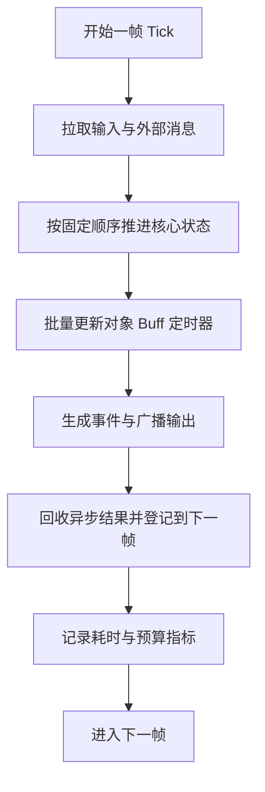

# Tick-driven Execution and Logic Execution

## Category

server / runtime subtree. Node positioning: Tick is the shared foundation of the main loop, the unit of scheduling, the performance budget, and recovery semantics -- making the order clear is its most valuable part.

## Definition


Tick-driven execution and logic execution are about more than "how many times per second it runs"; they are about how the runtime organizes work around logical time. As long as a system has room combat, Buff and skill timing, frame sync or state sync, periodic tasks, and object updates, Tick stops being just a timer and becomes the shared foundation of the main loop, the unit of scheduling, the performance budget, and recovery semantics.

## Problem

Discussing Tick is not about "how many times per second": room combat, Buff and skill timing, frame sync, periodic tasks, and object updates all organize work on logical time. If the order is not made clear and the frame budget is not set in advance, performance and recovery semantics will be rediscovered inside an incident.


### Why Tick is a runtime problem and not just a sync problem

Chapter 4 already covered Tick from the combat and sync angles; what needs supplementing here is the runtime perspective. From the runtime perspective, Tick decides:

- Which steps a round of logic execution contains.
- Which tasks are done in this frame and which are deferred to the next.
- How to catch up, skip, or degrade when a frame goes over budget.
- Which modules share the same time base.

So Tick-driven is not a network feature, it is part of the entire logic execution model.

### What a complete Tick loop usually contains

A complete logic Tick is usually not just "update the object list"; it may also include:

1. Collect and arrange inputs.
2. Consume messages delivered cross-thread or cross-service.
3. Advance the core state machine.
4. Update objects, Buffs, projectiles, and timers.
5. Generate combat events or broadcast events.
6. Process this frame's persistence or async delivery results.
7. Measure cost, record metrics, and prepare the next frame.

If the order of these steps is never written down explicitly, the system appears to have a Tick but is actually just several modules each "updating once roughly every frame."

### What is most valuable about Tick-driven is making the order clear

For a lot of game logic, order matters more than parallelism. The biggest payoff of Tick is usually:

- Stable execution order.
- A unified time base.
- Clear event production points.
- Replay and re-enactment become easier.
- Problem localization can land on a specific frame.

Because of this, many core runtimes keep key logic advancing around a single Tick main loop even when they have multiple threads.

### What Tick-driven most fears

The most common runtime problems usually include:

- Single-frame work is uncontrollable and suddenly goes over budget.
- Some async results insert at any time, breaking execution order.
- Different modules each maintain their own clock.
- Peripheral tasks and core logic compete for the same frame budget.

Once these problems appear, the symptom is rarely an immediate crash; it is usually:

- Ordering becomes harder and harder to explain.
- Frame cost jitters at peak.
- Frame catch-up and frame patching costs rise.
- Replay and live behavior drift further apart.

### How Tick and async tasks should coordinate

Tick-driven does not mean every piece of work must be finished inside the main loop. A more reasonable approach is usually:

- Core state advancement and order-sensitive logic stay on the Tick main path.
- Outsourcable heavy tasks go to a thread pool or task system.
- Async results return at a clear boundary to be consumed in the next frame.

The key point: async work may run in parallel, but final write-back and state taking effect should still be organized by Tick order.

This lets you use parallel capability without breaking up the ordering of the main logic.

### Frame budgets and throttling cannot be bolted on later

Tick-driven systems need budget thinking very much. Things commonly needing budgets include:

- How many objects at most a single frame processes.
- How many external messages at most a single frame consumes.
- How many frame patches at most a single frame performs.
- Whether async result reclamation has a limit.

If these budgets do not exist, the system may show no problem in normal operation, but at peak you get the "a few frames are especially slow, and then the whole path starts to avalanche" situation.

### Tick-driven and batch processing are naturally a match

Many high-performance runtimes like to pair Tick with batch processing, and there is a reason. Because once logic advances around a fixed period, it becomes easier to:

- Process homogeneous objects in batches.
- Apply state changes in batches.
- Emit events in batches.
- Write statistics and logs in batches.

This is also why Tick-driven often appears together with ECS, batch AI, batch collision, and event aggregation. They are all exploiting the engineering advantage of "doing the same kind of thing inside the same time slice."

### When you should not force something into Tick

Not every piece of logic is worth putting into the Tick main loop. For example:

- Large file downloads.
- Slow queries.
- Peripheral notifications.
- Background statistics with high latency tolerance.

Forcing these into the Tick main path usually only pollutes the budget and the ordering. The safer approach is to let them live asynchronously, but return them to the Tick boundary when they enter core state.

### A main loop model closer to practice



The point of this path is not its form, but fixing down "what is done when."

### Common pitfalls

- Thinking that having a timer makes it Tick-driven, while the modules each maintain their own clock and each decide their own execution order.
- Stuffing every task into the main loop, so the frame budget gets polluted by peripheral work.
- Letting async results write back to core state at any time without passing through a frame boundary, eventually destroying ordering inferrability completely.

What Tick is really worth is not "neatness," but that it makes the runtime inferrable, replayable, and governable.

### Practical case: triaging frame-budget pollution in a "the on-the-hour event starts and combat frame cost avalanches" incident

> This case is a demonstration example (not drawn from a real project), with numbers rounded and simplified. It pushes this page's "What a complete Tick loop usually contains," "How Tick and async tasks should coordinate," and "Frame budgets and throttling cannot be bolted on later" into deep water: frame cost is very stable normally, but it jitters as soon as the on-the-hour mark is hit -- this is the triage of peripheral tasks polluting the frame budget, and also a full unfolding of "how to keep peripheral work outside the Tick boundary."

**Background and symptoms**: one MMO, where starting the on-the-hour event (server-wide announcement + server-wide reward issuance) makes combat frame cost P99 jitter from **8** ms to **90** ms for about **40** seconds; the player perception is "it stutters every hour on the hour," with visibly delayed skills. After the event ends, frame cost falls back on its own, and nothing looks wrong in normal operation.

### Step 1: symptoms and caliber -- align the jitter window with the event window

Frame cost caliber: P99 **8** ms -> **90** ms, the jitter window exactly overlaps the on-the-hour event window, lasting **40** seconds before falling back.

Workload caliber: within a single frame, mixed in with combat object updates were the server-wide announcement broadcast, reward issuance, and event tracking reports -- all three are peripheral tasks sharing the same frame budget as core combat.

Contrast caliber: replaying the event traffic at a **1/10** gray release reduced frame cost jitter proportionally -- confirming the event workload went directly into the main loop.

### Step 2: layered attribution -- investigate against this page's Tick-fears checklist

```text
帧耗时雪崩归因  占比
  外围任务塞进 Tick 主链，污染帧预算         58%
  异步结果随时写回核心状态，不经帧边界        27%
  无单帧预算上限，超预算也没有降级           15%
```

Item-by-item comparison: peripheral tasks and core logic compete for the same frame budget (items two and four of this page's "What Tick-driven most fears"); async results (reward issuance callbacks, event tracking write-backs) insert into core state at any time, breaking execution order; there is no single-frame budget, and no degradation lever when over budget, so the whole frame can only get slower.

### Step 3: root cause -- the frame budget was polluted by peripheral work, and async results bypass the frame boundary

During the change, announcements, rewards, and event tracking -- these peripheral tasks -- were written directly into the main loop, and no single-frame budget limit was set. Core state advancement and peripheral work fought over the same frame budget, while async results wrote back bypassing the frame boundary, so ordering and budget both ran out of control.

### Step 4: remediation and backfill -- keep peripheral work outside Tick, write budgets into the main loop

1. Outsource peripheral tasks asynchronously: hand announcement broadcast, reward issuance, and event tracking reports to the task system, consume their results uniformly at the next frame boundary, and stop inserting them into the main loop on the spot.
2. Single-frame budget: at most **N** objects per frame, at most **200** external messages consumed, at most **4** frames patched, and anything beyond that defers to the next frame.
3. Over-budget degradation: when approaching budget, degrade peripheral presentation first (announcement delay, event tracking sampling), and core combat adjudication stays unaffected.

Verification ledger: P99 frame cost **90** ms -> **9** ms; on-the-hour stutter complaints cleared; frame cost jitter converged to the normal baseline, and the event period no longer avalanches.

**Backfill checklist**:

| Backfill item | Action | Backfill location |
|-----|------|--------|
| Tick loop step order | Write down the seven-step order of a frame; peripheral tasks do not enter the core advancement stage | What a complete Tick loop usually contains |
| Async back to the frame boundary | Async results are consumed uniformly at the next frame boundary and never write back to core state at any time | How Tick and async tasks should coordinate |
| Frame budget | Set separate limits on per-frame object count, external message count, and frame patch count; defer when over budget | Frame budgets and throttling cannot be bolted on later |
| Do-not-Tick-ify list | Announcements, rewards, event tracking, and slow queries are listed as not entering the main loop | When you should not force something into Tick |

### Three lessons from the case

1. **Once the frame budget is polluted by peripheral work, the on-the-hour mark becomes an avalanche point**. Work like announcements and rewards that got "conveniently stuffed into the main loop" is exactly the last straw that breaks the frame budget.
2. **Async results must be consumed back at the frame boundary, never written back at any time**. Async write-back that bypasses the frame boundary breaks up execution order, and the sequencing can no longer be explained.
3. **Budgets are designed, not bolted on after a stress test**. Without a single-frame limit, the system shows no problem in normal operation, and at peak you get "a few frames are especially slow, and then the whole path starts to avalanche."

## Used By

Tick loop design; frame budget and throttling planning; coordination conventions between async tasks and Tick.

- **Nakama** (commit `e920249`): the match beat is a runtime Tick -- each match holds a ticker and three input queues (callCh/joinAttemptCh/signalCh) on a single goroutine (`server/match_handler.go:102-105`), the beat is `time.NewTicker(time.Second / Rate)` (same file `:176`), and queue capacity is taken from config (`:163-165`)

## Related

Dependency chain: runtime foundation -> loop composition -> ordering -> what it most fears -> async coordination -> frame budget -> affinity with batch processing. Upstream: runtime/01 (the scheduling face of execution models), sync/01 (time model). Downstream: server/sync (the consumer of combat timing).

## Reference

This page is a synthesis of engineering experience; the practical case in the page is a demonstration example (numbers rounded and simplified).


## References

- [Gaffer on Games · Fix Your Timestep!](https://gafferongames.com/post/fix_your_timestep/)
- [Wikipedia · Game loop](https://en.wikipedia.org/wiki/Game_loop)

<!-- BACKLINKS-AUTO -->
## Related pages

- [10](/glossary/10.md)
- [index](index.md)
