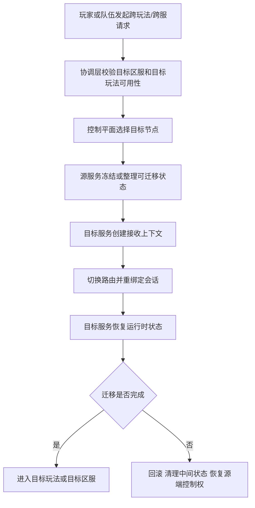

# Coordination Layer, Cross-Server, and the Control Plane

## Category

server / services subtree. Node positioning: beyond the data plane a control plane will sooner or later have to grow — the coordination layer, cross-server migration, the list of control plane capabilities, and the consequences of not having one.

## Definition


Many projects early on have only a data plane and no real control plane. That is, nodes can handle player requests, rooms can advance combat, scenes can maintain state, but there is no formal layer in the system answering these questions one level higher:

- Which node should a new room be placed on
- Who migrates and cuts traffic after a hot scene blows up
- When does a given region enter maintenance state
- Who commands players when they cross gameplay modes, scenes, or servers
- After a node fails, who decides the recovery path

When the project is small, these things are often limped along with manual configuration, temporary scripts, branching logic in the business layer, and implicit conventions. Once scale comes, they turn from "we can talk about it later" into the main system.

## Problem

Early on only the data plane can do work, but the higher-level questions — "is a node considered alive", "who does traffic land on", "where does state get moved" — are never formally answered: without a control plane, those answers live scattered in scripts and people's heads, and they burst out all at once during migrations and failures.


### First understand the data plane and the control plane separately

This is the most important step in understanding this chapter.

### What the data plane is responsible for

The data plane directly handles business traffic and runtime state, for example:

- A room server advancing a match
- A scene server maintaining map and object state
- An event server handling event progress
- A payment server flowing order state

### What the control plane is responsible for

The control plane does not advance business state directly; it organizes, governs, and commands those nodes, for example:

- Knowing which nodes are currently available
- Knowing which nodes are heavily loaded and which can accept a new instance
- Deciding where a new room, new scene, or new gameplay instance should land
- Managing draining, migration, maintenance state, scaling, and version gating
- Deciding switching and recovery actions in a unified way when a failure occurs

If a system has only a data plane and no control plane, the scheduling and governance logic will inevitably scatter into the business code.

### Why the coordination layer will inevitably grow

As soon as the system enters any of the following stages, the coordination layer is almost unavoidable:

- Players need to switch between multiple gameplay modes and multiple nodes
- After a successful match, the team must be allocated to some instance node
- The number of world or scene nodes changes dynamically
- Cross-server gameplay needs a new topology organized temporarily
- Operations needs to do scaling out, scaling in, draining, migration, and maintenance state control

These actions naturally span multiple services and multiple nodes, and should not be decided by any single business service on its own.

### What is really hard about cross-server is not networking, it is migration

When teams do cross-server for the first time, they tend to understand it as "players from this server go to another server for one match, then come back". Once it becomes real engineering, the difficulty is almost never in communication itself but in state and control handoff:

- How identity and session are transferred
- Which state travels with the player, and which stays in the origin server
- How long-lived assets are confirmed during migration
- How to roll back when it fails midway
- How to settle and archive after it ends

So cross-server is essentially not one RPC — it is a complete path carrying state tidying, session rebinding, control handoff, and failure recovery semantics.

### What capabilities does the control plane usually have to carry

In a mature project the control plane is not necessarily a single process, and not necessarily an independent product, but it will usually gradually consolidate the following capabilities:

- Service registration and health checks
- Node grouping, capacity views, and load information
- Allocation of rooms, scenes, and gameplay instances
- Region state management, for example open, read-only, maintenance, offline
- Migration, traffic cutover, draining, and scaling orchestration
- Global config distribution, version compatibility, and gating control

These capabilities do not produce gameplay content themselves, but they determine whether the system can be operated stably.

### A migration path closer to real engineering



What this path really wants to emphasize is that the difficulty of cross-server and migration is not in "sending the packets over", but in "who holds control at what time, and how to recover to a single source of truth after a failure".

### What happens when there is no control plane

When a system has no formal control plane, the common symptoms are usually:

- Room allocation strategy is hardcoded in the matchmaking service
- Scene migration strategy is hardcoded in the scene node
- Scaling relies on manual config edits and service restarts
- Node draining relies on temporary scripts and manual broadcasts
- A player reconnecting cannot find the currently correct instance

It runs fine in the early stage, but later on, once it enters hot events, cross-server gameplay, failure traffic cutover, and multi-region operation, the system becomes harder and harder to command.

### The three places where the coordination layer is most easily done badly

### Scattering scheduling logic across every business service

Short term it really is convenient, but the consequence is that any scheduling strategy adjustment requires changing multiple services at once, and the system has no unified view globally.

### Only static configuration, no real-time node state

If the control plane only knows "which nodes exist in theory" but not whether a node is currently healthy, its capacity, and its load, it is hard to make correct allocation decisions, and in the end it can only rely on experience and manual fallback.

### Only allocating, not rolling back or recovering

Many systems can do "send the player over" but cannot do "what if sending the player over failed". Without rollback and recovery semantics, migration and cross-server will sooner or later produce double binding, half-migration, and state left hanging in mid-air.

### When is it no longer optional

Once a project enters the following stages, the control plane usually stops being a supporting capability and becomes infrastructure:

- Multiple regions operating in parallel
- Multiple gameplay mode nodes deployed independently
- Large events needing dynamic orchestration
- Hot rooms or scenes needing elastic scaling
- Operations needs explicit entry points for maintenance state, draining, migration, and traffic cutover

At this point, continuing to hide scheduling capability inside business code carries a very high long-term cost.

### Common pitfalls

The most common error is having only a data plane and no formal control plane. The second is understanding cross-server as a simple remote call, without handling state migration, session switching, and failure rollback. The third is scattering coordination logic across the various business services, so there is no unified scheduling view globally and no stable operational entry point.

### Practical case: a missing-control-plane investigation where "cross-server events opened, and players got stuck in 'migrating'"

> The case is a demonstration example (not drawn from a real project); the numbers are rounded for simplicity. It drives this page's "What is really hard about cross-server is not networking, it is migration", "What capabilities does the control plane usually have to carry", and "The three places where the coordination layer is most easily done badly" into deep water: the migration sent the packets out, but nobody took over control — this is a data-plane-only investigation, and the full expansion of "a migration path carrying failure recovery semantics".

**Background and symptoms**: An MMO opened cross-server arena for the first time; two days after launch the migration failure rate was **6%**, and after failure players were stuck in "migrating" — unable to enter the gameplay and unable to return to the origin server; half-migration states and double bindings accumulated over **300** cases, and customer support could only unbind by manually editing the database.

### Step 1: Symptoms and caliber — no rollback on failure, and state hangs in mid-air

Failure caliber: migration failure rate **6%**, and after failure there was no rollback path — intermediate state not cleaned up, routing not switched back, source-side control not restored, so players hung in "migrating".

Scheduling caliber: room allocation strategy was hardcoded in the matchmaking service, scene migration strategy was hardcoded in the scene node, and the cross-server event wrote yet another set — the same question of "which node should it land on" had three answers, and there was no unified view globally.

Node caliber: the control plane had only one static node list, and did not know which node was currently healthy or how much capacity remained; the cross-server peak pushed all new instances onto a single node that was already near saturation.

### Step 2: Layered attribution — comparing against the three "done badly" points on this page

```text
迁移故障归因  占比
  只负责分配，不负责回滚和恢复       52%
  调度逻辑散落业务服务，无统一视图    33%
  只有静态配置，没有实时节点状态      15%
```

Compared item by item: hanging after failure and double binding accounted for the largest share — hitting "only allocating, not rolling back or recovering"; the three kinds of scheduling strategy each wrote their own — hitting "scattered scheduling logic"; the static list causing pressure onto a saturated node — hitting "no real-time node state". All three points hit, and the missing rollback had the largest blast radius.

### Step 3: Root cause — treating cross-server as one remote call

The team treated cross-server as "sending the packets over": once the target node created its context and the routing was switched, it was considered done — no failure rollback, no single source of truth for control handoff. Cross-server is essentially not one RPC, but a complete path carrying state tidying, session rebinding, control handoff, and failure recovery semantics — the entire second half of the path was never built.

### Step 4: Disposition and backfill — filling in the second half of the path

1. Consolidate the control plane: service registration and health checks, capacity views, instance allocation, and migration orchestration first landed in the coordination layer, so scheduling strategy is no longer written separately everywhere.
2. Add rollback semantics to the migration path: on failure, roll back immediately — clean up intermediate state, switch routing back, restore source-side control, so a player retries at most once and is never left hanging.
3. Real-time node state reporting: health, capacity, and load enter the allocation decision, so a saturated node does not accept new instances.

Recheck ledger: migration failure rate **6%** → **0.4%**; half-migration and double binding **300** cases → **0** cases; the queue of tickets stuck in "migrating" cleared to zero; new orders accepted by an overloaded single node **0** times.

**Backfill checklist**:

| Backfill item | Action | Backfilled at |
|-----|------|--------|
| Control plane capability list | Registration health, capacity view, instance allocation, and migration orchestration each consolidated into the coordination layer | What capabilities does the control plane usually have to carry |
| Migration rollback semantics | On failure, clean up the intermediate state, switch routing back, and restore source-side control | A migration path closer to real engineering |
| Real-time node state | Health, capacity, and load reported in real time, so allocation decisions no longer look only at static configuration | Only static configuration, no real-time node state |
| Scheduling convergence | Room, scene, and cross-server allocation all go through the coordination layer; business services do not carry their own scheduling | Scattering scheduling logic across every business service |

### Three lessons from the case

1. **"Sending the packets over" is only half of migration.** Without rollback and recovery semantics, a failure becomes double binding, half-migration, and state hanging in mid-air.
2. **Scattered scheduling logic means no scheduling at all.** Three services with three answers, no unified view globally, and as soon as cross-server opens they immediately fight each other.
3. **Static configuration cannot support allocation.** Not knowing a node's current health and capacity, the control plane can only lean on experience and manual fallback.

## Used By

Control plane capability building; cross-server migration path design; checking the three "done badly" points of the coordination layer.

- **BigWorld** (commit `088d3b84`, paths relative to `programming/bigworld/`): two instances of control plane capability — cellappmgr dynamically balances load by spatial boundary (`server/cellappmgr/internal_node.cpp:310`, `:445`, `:470`), and baseappmgr maintains bestBaseApp and distributes it to loggers (`server/baseappmgr/baseappmgr.cpp:508`, `:532-540`)
- **KBEngine** (commit `0bc93d5`): component discovery is carried by machine — `findComponent` looks up by component type (`kbe/src/server/machine/machine.cpp:72`, `:113`), and the internal management port goes through the configured port pool 30099-30199 (`kbe/res/server/kbengine_defaults.xml:244-245`)

## Related

Relationship chain: the two planes → the coordination layer grows → cross-server migration → control plane capabilities → the migration path → the consequences of no control plane → the done-badly points. Upstream: services/01. Downstream: glossary/07 (the control plane entry), server/capacity/03 (migration and server merge).

## Reference

This page is a synthesis of engineering experience; the practical case inside the page is a demonstration example (numbers rounded for simplicity).


## References

- [Wikipedia · Payment system](https://en.wikipedia.org/wiki/Payment_system)
- [Wikipedia · Game server](https://en.wikipedia.org/wiki/Game_server)

<!-- BACKLINKS-AUTO -->
## Related pages

- [knowledge](/knowledge.md)
- [02-engine-middleware-docs](/research/02-engine-middleware-docs.md)
- [index](index.md)
- [genre-coverage](/system/genre-coverage.md)
