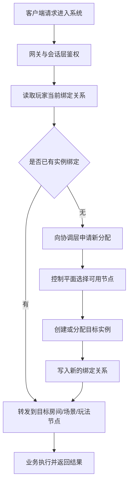

# Service Discovery, Routing, and Collaboration

## Category

server / services subtree. Node positioning: the first question after splitting is "where does this request go" — service discovery, four classes of routing, getting it wrong is scarier than not finding it, collaboration over mutual invocation.

## Definition


Once services are split apart, the system immediately has to answer a very concrete question: where exactly does this request belong? Which gateway should a player land on after login, which room node should they enter after matchmaking completes, which instance should they return to on reconnection, and how should binding relationships be switched during cross-server migration. Taken together, all of these questions are what "service discovery, routing, and collaboration" is genuinely worth as an engineering discipline.

Many systems can limp along early on with static configuration, an in-process routing table, or simple hashing, but once node count, gameplay types, and operational actions multiply, this layer rapidly moves from a peripheral function to the central problem.

## Problem

Which gateway login lands on, which node matchmaking enters, which instance reconnection returns to, how migration switches bindings — one routing error and a player ends up in the wrong room, a P0 incident. The implementation mechanism is not the point; the governance rules are: a routing system survives on rules, not on frameworks.


### What service discovery is actually discovering

Service discovery is not simply grabbing an IP and a port. From a game-engineering standpoint it must at least know:

- which nodes are currently available
- what role each node carries
- which nodes a given class of gameplay instance can be allocated to
- the current health, capacity, and acceptance status of each node
- which instance a given player, team, or room is currently bound to

If the system only discovers "addresses" and not "responsibilities, state, and capacity", the routing decisions downstream will inevitably be coarse and brittle.

### Why game routing is harder than ordinary business routing

In many ordinary business systems a request can hit a unified entry point and let a load balancer distribute it randomly or by rule. Game routing is naturally session- and state-bound:

- the same player must return to the original room or original scene after reconnecting
- players in the same room must land on the same instance
- a team entering a dungeon often needs to be bound as a whole
- a cross-server event has to enter a specific gameplay cluster
- after a hotspot scene migrates, its binding must switch over as a whole

That means game routing is not random traffic splitting but a binding system organized around session and state ownership.

### Routing is actually at least four classes

### Entry routing

Directs a player from the login entry or gateway to the correct business domain — region, server, platform group, version environment.

### Session routing

Maintains which room, scene, or gameplay instance the player is currently bound to. Reconnection, handoff, trusteeship, and migration all depend on it.

### Inter-service routing

Chooses the target of a service call — e.g. which event instance an activity request should hit, which settlement path a given room's settlement should be sent to.

### Migration routing

Changes binding relationships across gameplay types, scenes, and servers, and guarantees the old-to-new binding switch is ordered and recoverable.

Squeezing all of these completely different problems into one "unified routing layer" usually yields only a pile of fuzzy branch logic. The more solid approach is to pin down the state source, update conditions, and invalidation semantics for each routing class.

### What a routing system fears most is not "can't find", but "found the wrong one"

Production incidents very often are not a total addressing failure, but these harder-to-diagnose problems:

- landed on a node that should not have been visited
- routing information is already stale
- a player's binding was updated only halfway
- the service discovery layer thinks a node can accept, while the node has already drained
- reconnection sent the player back to the old node, but the instance has already moved

So what service discovery and routing really solve is not "can we connect" but "can the request reach the target that is currently correct and still valid".

### Why collaboration matters more than "just calling each other"

Many teams understand service collaboration as "the interface calls go through". That is far from enough. Real collaboration means at least:

- multiple services around the same business path have clear responsibility divisions
- the upstream knows when to wait synchronously and when to let go asynchronously
- the downstream knows what to return, what to retry, and what to compensate after failure
- all participants share one understanding of binding relationships, control, and completion conditions

The core of collaboration is not calling each other's interfaces, but that when multiple services jointly complete one thing, the boundaries and failure semantics are formally written down.

### A request flow closer to real engineering



What this path really wants to stress is that instance allocation and binding writes should not be decided ad hoc by each business node; there should be unified semantics and a single source of truth.

### The implementation mechanism is not the point; the governance rules are

Whether you use a registry, a custom routing table, a service mesh, or any other scheme, what usually decides quality is not the middleware's name but whether these governance rules exist:

- how often node state is refreshed
- whether health checks are trustworthy
- whether routing changes have atomic semantics
- whether node draining has a formal process
- whether player-instance bindings have a single source of truth

With those problems unsolved, the most mature component is just accelerating the chaos.

### What exposes problems best is not normal traffic, but abnormal paths

The most honest acceptance scenario for a routing system is usually not day-to-day requests but these moments:

- player disconnects and reconnects
- a node fails over
- a room migrates
- a scene migrates
- server maintenance, draining, and recovery

If problems keep surfacing in these scenarios, the service discovery and routing system has not truly been built.

### Common pitfalls

The most common error is treating service discovery as "grab a set of addresses", ignoring role, health, capacity, and bindings. The second is letting every business service maintain its own routing logic, so that at migration and reconnection time there is no global source of truth. The third is designing only the normal path and not the collaboration semantics for node draining, binding invalidation, and failed migrations.

### Practical case: a stale-routing investigation of "landed in the wrong room after reconnection"

> The case is a demonstration example (not drawn from a real project); the numbers are rounded for simplicity. It drives this page's "Routing is actually at least four classes", "What a routing system fears most is not 'can't find', but 'found the wrong one'", and "The implementation mechanism is not the point; the governance rules are" into deep water: addressing always succeeded, the target was just the old one — this is an investigation of "getting it wrong is scarier than not finding it", and the full unfolding of "bindings need a single source of truth".

**Background and symptoms**: A competitive mobile game turned on room migration; of the players who disconnected and reconnected, about **90** per day landed in the wrong room — connected, and sat down inside someone else's match. During triage every request addressed successfully, and not a single one reported "not found".

### Step 1: Symptoms and caliber — first tell "can't find" from "found the wrong one"

Wrong-target caliber: every failed request successfully connected to *some* node, it was just the wrong target — not an addressing failure but stale routing information.

Binding caliber: the player's binding was only half-updated — the migration wrote the new binding but never invalidated the old one, so both records coexisted and the reconnection logic read the old record.

Draining caliber: the service discovery layer believed the node could accept, but the node had already drained — draining was done by ops hand-editing config ad hoc, and the state never propagated into the discovery layer.

### Step 2: Layered attribution — compare against this page's "found the wrong one" checklist

```text
进错房间归因  占比
  绑定关系无单一真相源，更新非原子    54%
  摘流无正式流程，发现层状态滞后      28%
  重连回到旧节点，但实例已迁走        18%
```

Item by item against the list: three of the five "found the wrong one" items hit — binding updated only halfway, discovery layer thinks it can accept while it is actually draining, and reconnection sent the player back to the old node while the instance had already moved. What the three problems share: every business service maintained its own routing logic, so at migration and reconnection time there was no global source of truth.

### Step 3: Root cause — routing changes had no atomic semantics, draining had no formal process

Migration routing wrote the new binding and invalidated the old binding as two independent operations, so any failure in between left a duplicate record; node draining was a temporary script, and health state never entered the discovery layer. What a routing system fears most is not "can't find" but "found the wrong one" — landing on a node that should not have been visited is harder to diagnose than not connecting at all, because everything looks normal.

### Step 4: Disposition and backfill — give every routing class its full set of governance rules

1. Bindings consolidated to a single source of truth: migration routing's "write new, invalidate old" becomes an atomic operation with a version number; the reader trusts only the current version.
2. Draining goes through a formal process: drain first, wait for discovery-layer state to sync, then take the node offline; the draining entry point is consolidated into the coordination layer, no more ad hoc scripts.
3. The four routing classes are governed separately: entry, session, inter-service, and migration routing each pin down their own state source, update conditions, and invalidation semantics, instead of being crammed into one unified routing layer.

Recheck ledger: wrong-room **90** / day → **0**; duplicate binding records cleared to zero; false accepts during draining **0**; reconnection hit rate **99.2**% → **99.98**%.

**Backfill checklist**:

| Landing point | Action | Backfilled at |
|-----|------|--------|
| Single source of truth | A player-to-instance binding is stored as one authoritative record, with a version number | The implementation mechanism is not the point; the governance rules are |
| Atomic routing change | Migration routing's "write new, invalidate old" is atomic, eliminating duplicate records | Routing is actually at least four classes |
| Formal draining process | Drain first, sync state, then take offline; entry point consolidated into the coordination layer | What exposes problems best is not normal traffic, but abnormal paths |
| Four routing classes separate | Entry, session, inter-service, and migration routing each define their own state source and invalidation semantics | Routing is actually at least four classes |

### Three lessons from the case

1. **Getting it wrong is scarier than not finding it.** "Can't find" errors on the spot; "found the wrong one" looks perfectly normal until the player realizes they are sitting in someone else's match.
2. **Bindings must have a single source of truth.** A "write new, don't delete old" duplicate record is the entire source of reconnection-to-wrong-room.
3. **Abnormal paths are the acceptance scenario for a routing system.** If disconnect-reconnect, migration, and draining keep breaking, the routing system has not truly been built.

## Used By

Routing-system design; service discovery and binding conventions; cross-node collaboration review.

- **Pitaya** (commit `eaacc47`): a complete implementation of discovery and routing — etcd registry keys `servers/<serverType>/<serverID>` with lease grant/renew/watch (`pkg/cluster/etcd_service_discovery.go:280-282`, `:190`, `:119`), three-segment routing `svType.service.method` (`pkg/route/route.go:39-63`) dispatching locally or remotely (`pkg/service/handler.go:336-361`)
- **Nano** (commit `dbf22c7`): the gate/backend split is the de facto routing entry — node dual listening (inter-node gRPC service port `cluster/node.go:136`, client port `:236`), cluster master/member relying on heartbeat reporting (`cluster/member.go:30-41`)
- **Leaf** (commit `af71eb0`): the static-configuration comparison surface — cluster is purely static, listens on `conf.ListenAddr`, connects to `conf.ConnAddrs`, no service discovery (`cluster/cluster.go:15-30`, `conf/conf.go:17-18`)

## Related

Relationship chain: what to discover → game routing is harder → four routing classes → found the wrong one → collaboration > mutual calls → request flow → governance rules. Upstream: services/01/02. Downstream: glossary/07, database/cache/03 (service discovery and consistent hashing).

## Reference

This page is a synthesis of engineering experience; the practical case inside the page is a demonstration example (numbers rounded for simplicity).


## References

- [Wikipedia · Time series database](https://en.wikipedia.org/wiki/Time_series_database)
- [Wikipedia · Game server](https://en.wikipedia.org/wiki/Game_server)

<!-- BACKLINKS-AUTO -->
## Related pages

- [knowledge](/knowledge.md)
- [02-engine-middleware-docs](/research/02-engine-middleware-docs.md)
- [index](index.md)
