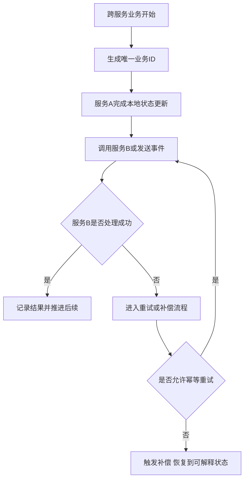

# Consistency, Recovery, and Reconnection

## Category

server / services subtree. Node positioning: consistency splits into two classes, recovery is designed alongside consistency, idempotency and compensation are standing capabilities, reconnection semantics are written down in advance — the real cost that a distributed chain carries together.

## Definition


Once services are split, consistency, recovery, and reconnection are no longer local problems of a single module; they are the real cost that the entire system chain must carry together. In a monolith, a transaction failure might just be a local rollback; in a distributed system, the more common picture is:

- this side wrote successfully, that side timed out
- the player session has already migrated, but the old node has not fully shut down
- the room has ended, but settlement wrote back only halfway
- the client reconnects, but the binding switch has not finished

So what is really under discussion here is not the full compendium of distributed consistency theory, but which states in a game project need how strong a consistency, which states can accept eventual consistency, and what recovery relies on after failure.

## Problem

In a monolith a transaction failure might just be a local rollback; once split, the same failure amplifies along the chain. Consistency, recovery, and reconnection are not local problems of a single module — if reconnection semantics are not written down in advance, the incident scene becomes the place where they are defined for the first time.


### First split consistency into two classes

Without stratifying first, you will almost certainly fall into the pitfall of "everything wants strong consistency".

### Runtime consistency

This class of consistency concerns whether transient state during rooms, scenes, matchmaking, and migration is self-consistent, e.g.:

- whether the same player belongs to only one instance
- whether a single session settles only once
- whether the old and new nodes never hold control simultaneously during migration
- whether the session returns to the correct runtime context after reconnection

### Long-term asset consistency

This class of consistency concerns whether long-term state such as rewards, currency, items, quests, leaderboards, and payment results is ultimately trustworthy, e.g.:

- were rewards granted more than once
- were assets lost or double-deducted
- did records, leaderboards, and settlement converge eventually
- did shipping complete eventually after a successful payment

These two classes are usually handled differently. Trying to solve them both with one set of strong-transaction tools is typically both heavy and slow.

### Why recovery capability must be designed together with consistency

Many systems only discuss "how the normal path succeeds" and not "what happens after failure". This means that the moment something goes wrong in production, the team has no choice but to crawl logs by hand and patch data by hand.

In real projects these things are bound to happen sooner or later:

- a node exits abnormally
- a cross-service call times out
- control-plane scheduling fails
- the client disconnects and reconnects
- a player migration is interrupted
- room settlement fails midway

What recovery capability really has to answer is: after failure, how does the system return to a state that is explainable, continuable, and compensatable.

### The most common recovery problems in game systems

### Player reconnection

Reconnection is not as simple as "just reconnect to the gateway". It usually involves all of the following at once:

- session restoration
- routing re-localization
- room or scene instance lookup
- recent-state restoration
- re-confirmation of results that completed but the client never acknowledged

If these semantics are not defined in advance, so-called "sporadic reconnection problems" are usually just the system having no formal design for the recovery path.

### Node migration

Room migration, scene migration, hotspot traffic shifting, draining, and scaling up are all, at their core, control-transfer problems. The most important thing here has never been "copying the data over" but "how the old and new nodes hand over control, and where to fall back to on failure".

### Cross-service chain failure

For example, room settlement completed but reward granting timed out; payment succeeded but asset write-back failed; event progress updated but the record was never written. Problems like this almost never can be solved by a single call; they must rely on idempotency, compensation, and recovery semantics.

### Why idempotency and compensation are standing capabilities

Many cross-service chains are simply unsuited to relying on one giant global transaction. The more realistic approach is usually:

- key operations carry a unique business ID
- each service does idempotent handling based on the business ID
- after failure, enter an explicit retry or compensation path

For example:

- the same battle's settlement arriving twice does not grant rewards twice
- the same payment callback firing twice does not ship twice
- the same migration request running twice does not double-bind the player

Idempotency is not an add-on optimization; it is the infrastructure that makes distributed recovery actually workable.

### Why reconnection semantics must be written down in advance

A mature system usually pins these questions down in advance instead of waiting for a production error and then guessing:

- how long is the reconnection window
- which service is the source of truth for the player's current state
- does the room or scene keep advancing while the player is disconnected
- after reconnection, pull a snapshot, catch up on deltas, or re-enter the session
- how are results that completed but the client never received re-confirmed

As long as these semantics are fuzzy, every subsequent reconnection bug will look like a random fault — when in reality the rules were never written down clearly.

### A recovery chain closer to real engineering



What matters most about this chain is not the flowchart but two things:

- every key business operation must have a unique identifier
- every failure must have a clearly defined destination, rather than stalling in a half-finished state

### Where recovery capability usually belongs

A more solid system usually plants recovery landing points in these locations in advance:

- recent-state snapshots of rooms and scenes
- player session bindings and migration records
- unique business numbers for settlement, rewards, and orders
- control-plane scheduling operation logs
- retry, compensation, and audit records of key long chains

With these facilities in place, after a fault the system can at least recover toward "explainable" rather than relying entirely on human brainpower to stitch logs together.

### How to trade off consistency strength by tier

Not every chain deserves equally strong consistency. The more realistic approach is usually:

- in-session high-frequency state prioritizes clear runtime semantics, accepting local eventual convergence when necessary
- long-term assets prioritize idempotency, auditability, and eventual correctness
- peripheral notifications and low-value chains are allowed to be delayed and must not drag down the primary path

This kind of tiering is closer to a long-term maintainable engineering approach than trying to make every state synchronized and strongly consistent.

### Common pitfalls

The most common error is discussing only how the normal path collaborates, not how to recover after failure. The second is trying to solve every consistency problem with one unified strong transaction, ending with both complexity and performance out of control. The third is having no unique business ID and no idempotency semantics, so that retries, callbacks, and reconnections immediately produce duplicate side effects. The fourth is treating reconnection as a small access-layer feature instead of putting it back into the cross-service state-recovery chain to be designed together.

### Practical case: a duplicate-side-effect investigation of "settlement granted rewards twice"

> The case is a demonstration example (not drawn from a real project); the numbers are rounded for simplicity. It drives this page's "Why idempotency and compensation are standing capabilities", "Why reconnection semantics must be written down in advance", and "Where recovery capability usually belongs" into deep water: the normal path is not off by a penny, the failure path is all duplicates — this is an investigation of cross-service half-finished chains, and the full unfolding of "every failure must have a clearly defined destination".

**Background and symptoms**: A mobile game's seasonal settlement went live and players complained of duplicate rewards; month-end reconciliation found **217** duplicate reward grants; the same month, repeated payment callbacks caused **30** duplicate shipments. The commonality: the chain was only ever designed for the "everything goes well" case.

### Step 1: Symptoms and caliber — first count where the duplicate side effects come from

Settlement caliber: after room settlement finished, the reward-granting call timed out; the settling side retried on timeout, but the granting side had in fact already sent them — the same reward was granted twice, and no number anywhere in the chain could identify "this is the same settlement".

Callback caliber: the payment platform's callback was re-pushed; the shipping service did not do idempotent handling on order number, so the same order shipped twice.

Reconnection caliber: after reconnection, the client confirmed again a "completed but never received" settlement result, triggering a second grant — reconnection semantics were never written down in advance, and every stage compensated according to its own interpretation.

### Step 2: Layered attribution — ledger by source of duplicate side effects

```text
重复副作用归因  占比
  无唯一业务 ID 与幂等，重试即重复     58%
  失败无补偿路径，链路停在半完成       27%
  重连语义未定义，已完成结果被再确认    15%
```

Item by item: settlement retry and callback re-push are the bulk — both are missing unique business IDs and idempotency semantics, so retries, callbacks, and reconnections immediately produce duplicate side effects; reward granting timed out and neither retried nor compensated, leaving the chain stuck half-finished — which hits the most common recovery problem "room settlement completed but reward granting timed out"; reconnection re-confirmation is the remainder.

### Step 3: Root cause — only the normal path was designed, failure had no destination

The whole settlement chain only discussed how the normal path collaborates: settlement succeeds, grant succeeds, client displays. Whether to retry or compensate after failure, who retries, and how to guarantee no duplication were all undefined. Idempotency is not an add-on optimization but the infrastructure that makes distributed recovery actually workable — without it, every timeout retry is a fresh duplicate side effect.

### Step 4: Disposition and backfill — give every failure a clearly defined destination

1. Key operations carry a unique business ID: settlement slips, orders, and migration requests each generate a unique number; reward granting is idempotent on settlement number, shipping is idempotent on order number.
2. Failure enters an explicit path: do not blindly retry on timeout — first query the grant result; if not yet granted, retry with the original slip number; if already granted, mark complete and return the result.
3. Reconnection semantics are pinned down in advance: reconnection window, which service is authoritative, pull snapshot or catch up deltas, how to re-confirm completed-but-unacknowledged results — written line by line into the design document.
4. Recovery landing points are pre-planted: unique business numbers for settlement and orders, retry/compensation/audit records for key long chains, all registered in the recovery facility inventory.

Recheck ledger: duplicate rewards **217** / month → **0**; duplicate shipments **30** → **0**; half-finished dangling chains cleared; average recovery time for timeout settlements dropped from **2** days of manual reconciliation to **5** minutes of automatic compensation.

**Backfill checklist**:

| Landing point | Action | Backfilled at |
|-----|------|--------|
| Unique business ID and idempotency | Settlement slips and orders carry unique numbers; granting and shipping are idempotent on the number | Why idempotency and compensation are standing capabilities |
| Failure compensation path | On timeout, query the result first, then retry or compensate; the chain never stalls half-finished | A recovery chain closer to real engineering |
| Five reconnection questions | Window, authority, advancement strategy, snapshot-vs-delta, re-confirmation — each pinned down | Why reconnection semantics must be written down in advance |
| Recovery landing points | Business numbers, binding records, retry/compensation/audit all pre-embedded in the recovery facilities | Where recovery capability usually belongs |

### Three lessons from the case

1. **Design only the normal path and failure will invent its own.** The settling side retried on timeout, the granting side shipped on request, and the two "correct" logics stitched together one duplicate grant.
2. **Idempotency is infrastructure, not optimization.** Without a unique business ID, retries, callbacks, and reconnections are each an entry point to duplicate side effects.
3. **Every failure must have a clearly defined destination rather than stalling half-finished.** Retry, compensate, or abandon — write it down and you do not have to reconcile by hand.

## Used By

Distributed consistency scheme review; recovery chain design; idempotency and compensation capability building.

- **Orleans** (commit `b1b557d`): the abstraction exit for state and recovery — persistent `IPersistentState<TState> : IStorage<TState>` (`src/Orleans.Runtime/Facet/Persistent/IPersistentState.cs:10`), reminder system `IReminderService`/`IRemindable` carrying recoverable periodic tasks (`src/Orleans.Reminders/`), storage provider catalog externalized (memory/AdoNet/Azure/Redis/Cassandra)

## Related

Relationship chain: two classes of consistency → recovery designed alongside → common recovery problems → idempotency and compensation → reconnection semantics → recovery chain → landing points. Upstream: services/04 (the reliability surface of routing and collaboration). Downstream: database tree (transactional consistency), networking tree.

## Reference

This page is a synthesis of engineering experience; the practical case inside the page is a demonstration example (numbers rounded for simplicity).


## References

- [Wikipedia · Chatbot](https://en.wikipedia.org/wiki/Chatbot)
- [Wikipedia · Game server](https://en.wikipedia.org/wiki/Game_server)

<!-- BACKLINKS-AUTO -->
## Related pages

- [knowledge](/knowledge.md)
- [01-authoritative-books](/research/01-authoritative-books.md)
- [index](index.md)
- [settlement](/system/settlement.md)
