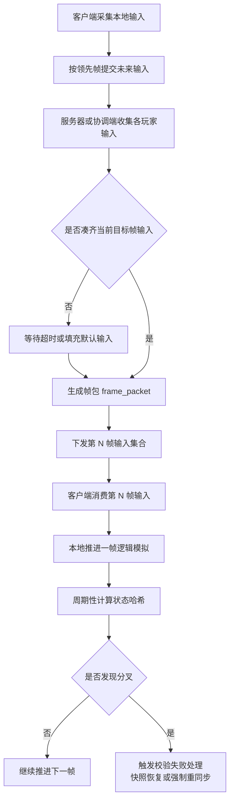

# Frame Sync in Depth

## Category

server / sync subtree. Node positioning: frame sync is a whole set of engineering around the shared logical frame -- input window, default inputs, catch-up, reconnection, and hash checks, none can be missing.

## Definition


Frame sync is not a slogan but a whole engineering approach to organizing combat around a "shared logical frame." Its core is not saving bandwidth but letting all participants advance combat around the same frame number, the same input window, and the same simulation rules. Many teams, when they first build frame sync, only remember "send inputs not state," and as a result they trip over every step that follows: delayed frames, default inputs, catch-up, reconnection, pause, and hash checks.

## Problem

Going to frame sync remembering only "send inputs not state" trips you over delayed frames, default inputs, catch-up, reconnection, pause, and hash checks. The hardest reality of frame sync is the input window and timeout policy -- it determines the engineering volume of the whole chain and cannot be added afterward.


### What does frame sync actually sync

The minimal definition of frame sync can be written in one sentence: all participants consume the same set of inputs on logical frame `N`, then advance to frame `N + 1` by the same rules. As long as inputs are consistent, order is consistent, and simulation is consistent, the final state should be consistent.

But frame sync in real projects does not come in only one shape. Common differences include:

- Who is responsible for aggregating inputs: the host, a coordinator server, or an authoritative server.
- Whether the server only organizes frame numbers or also participates in authoritative simulation.
- Whether inputs are sent only after being strictly aligned, or whether there is a timeout with default inputs.
- Whether clients are allowed to do partial feed-forward for the next few frames.
- Whether state is periodically snapshotted and hash-verified.

So "using frame sync" does not tell you what the system looks like; it only tells you the system chose to organize consistency by frame.

### Why many projects are drawn to frame sync

What usually attracts people to frame sync is three points:

- Input packets are typically lighter than full state broadcasting.
- Consistency, replay, and the adjudication language are naturally organized around the same frame number.
- For hard-competitive scenarios, many disputes can land on an explicit frame sequence.

This is also why RTS, some fighting games, hard-real-time room-based games, and some competitive projects have long favored it. But its truly expensive part is not transport but the supporting engineering.

### What a deployable frame sync depends on at minimum

A deployable frame sync typically needs at minimum the following core objects:

- `frame_id`: the current logical frame number, the shared language of all adjudication discussions.
- `input_delay`: how many frames ahead local inputs are submitted, leaving a buffer for network jitter.
- `input_buffer`: the buffer storing inputs for the next few frames.
- `frame_packet`: the input set for a given frame issued by the server or coordinator.
- `default_input`: the fallback input on timeout or disconnect, e.g. a no-op, holding direction, or proxy input.
- `state_hash`: periodically verifying whether current state is consistent.
- `checkpoint`: periodic snapshots for reconnection and long-session recovery.
- `catch_up_policy`: how a client behind on frames catches up, when to switch to a snapshot, and when to declare unrecoverable.

Missing any one of these, frame sync will easily break in edge scenarios.

### A frame sync chain closer to real engineering



This flow makes one thing clear: frame sync is not "everyone runs on their own," but a chain composed jointly by the input window, timeout policy, hash checks, and recovery strategy.

### Delayed frames and the input window are frame sync's hardest reality

Frame sync cannot truly achieve "current-frame inputs, all participants immediately and consistently executing on the current frame," because network propagation takes time. The real practice is usually:

- When the client is at local frame `L`, it submits the inputs for future frame `L + K`.
- `K` is the leading frames or input delay window.
- The server collects everyone's inputs for frame `L + K` and then issues that frame's packet.

Setting `K` too small makes the system easy to break under jitter; setting it too large noticeably degrades input latency feel. The essence of this window is buying time between immediacy and stability.

### Default inputs and timeout policy can never be added later

As long as a project has weak networks, disconnects, background suspension, and peak-time jitter, frame sync must answer one question: what does the system do if frame `N` keeps not receiving some player's input.

Common choices include:

- Judge it a timeout and do a no-op.
- Hold the previous frame's direction or the previous frame's input state.
- Enter proxy AI.
- Pause the whole session for a short recovery window.
- Directly declare defeat or force the player out of the room.

None of these is naturally correct; the key is matching the gameplay. But the biggest mistake is not defining it at all, so everyone ends up waiting for an input that will never come.

### State hashing and checkpoints are lifelines

In frame sync projects, the most dangerous thing is not packet loss but not knowing a divergence has happened. Client and server may both be running frames normally and both receiving frame packets, but a platform's floating point, a script branch, or a collection traversal order difference is enough to let the two slowly drift from frame 300 onward.

Therefore a frame sync system typically needs:

- Periodically computing key state hashes.
- Comparing hashes within the room for consistency.
- Quickly locating the earliest anomalous frame after a divergence.
- Retaining checkpoints and logs for a recent period.

Without these tools, an out-of-sync online session can usually only be caught "by feeling something is wrong."

### Why reconnection cannot rely only on frame-by-frame catch-up

In frame sync projects, if a reconnected client only recomputes frame by frame from the frame it disconnected, two problems easily arise:

- Falling too many frames behind, so the client never catches up.
- The client loading resources while patching logic, ending up more behind the more it patches.

So the safer practice is usually:

- Generate room checkpoints or combat snapshots periodically.
- On reconnection, preferentially load the most recent checkpoint rather than replaying from long ago.
- Catch up only a small segment of incremental frames after the checkpoint.
- When the catch-up threshold is exceeded, directly switch to snapshot recovery rather than blindly chasing frames.

Without snapshots, frame sync makes long sessions and reconnection experience hard to make stable.

### What systems are suitable for the frame sync primary path

Frame sync is best suited to those objects that directly affect win/loss and must advance around the same logical time:

- Character inputs and movement.
- Skill casting and hits.
- Buff triggers and removals.
- Projectile advancement.
- Core resource changes.
- Death, respawn, and settlement conditions.

Things that usually should not be forced into the primary path include:

- Pure presentation effects.
- UI animations.
- Non-critical sound effects.
- Peripheral system presentation unrelated to win/loss.

Stuffing everything into frame sync only makes the whole chain heavier.

### When is frame sync worth using

Frame sync is best suited to combat with the following characteristics:

- Extremely sensitive to fairness and timing.
- A relatively controllable number of core objects.
- The team willing to invest in determinism, hash checks, snapshots, and debugging tools.
- Accepting the introduction of a few leading frames for stability.

If the project leans more toward open worlds, strong server authority, complex peripheral systems, and a lot of non-deterministic content, pure frame sync is often not the most economical answer.

### Common pitfalls

- Understanding frame sync as "only send inputs, so it's simple."
- Having no default inputs and timeout policy, letting the whole session wait for disconnected players.
- Having no state hashing and checkpoints, so a divergence can only be fixed by restarting.
- On reconnection, trying to replay frame by frame from the disconnection frame, eventually dragging the client into permanent catch-up or permanent loading.

What truly makes frame sync hard is not whether it can run on day 0, but whether it can still explain itself clearly on day 100 when disconnect reconnection, cross-platform differences, and online disputes arrive.

### Practical case: triaging a "same frame, two machines with different input order" frame packet reordering

> This case is a demonstration example (not drawn from a real project), with numbers rounded and simplified. It pushes the page's "Delayed frames and the input window are frame sync's hardest reality," "State hashing and checkpoints are lifelines," and "Default inputs and timeout policy can never be added later" into deep water: inputs consistent, simulation consistent, yet state still diverges -- this is the triage of inconsistent input order within a frame packet, and also a full unfolding of "how to make inputs, order, and simulation all consistent."

**Background and symptoms**: an RTS mobile game, 4v4 sessions, frame sync approach. One month after launch the divergence rate was **0.7**% per session, manifesting as "both sides see different battlefields" mid-session; during replay review, the same session replayed differently on two machines, with a replay consistency rate of only **96**%, and **150** dispute tickets per day.

### Step 1: symptoms and caliber -- first use hashing to locate the earliest divergence frame

Hash caliber: comparing state hashes every **60** frames, the earliest anomalous frame in divergent sessions clustered **1400-1600** frames after the opening, and the divergence point always followed the same kind of operation.

Input set caliber: capturing the frame packet for the same frame, the 8 players' input set contents were identical but the **order differed** -- one machine by player join order, the other by internal hash table traversal order.

Simulation caliber: unit testing the same input set advanced in two orders, the state hash first differed at frame **1420** -- inconsistent order, inconsistent simulation results.

### Step 2: layered attribution -- triage item by item along the page's dependency list

```text
分叉局归因  占比
  帧包内输入未按固定顺序排序，遍历顺序不稳定    62%
  集合遍历依赖哈希表实现，跨平台顺序不同        26%
  默认输入填充顺序未定义                        12%
```

Triage path: input contents consistent (packet loss ruled out); simulation rules consistent (the same logic code, ruled out); the problem is in **order** -- the frame packet stuffs inputs into a collection without sorting, and collection traversal order depends on the language runtime, which may differ cross-platform and cross-version, so one machine starts to slowly drift from frame **1420**. This is exactly the page's "inputs consistent, order consistent, simulation consistent, then the final state is consistent" -- order was missing among the three.

### Step 3: root cause -- the input window collects inputs but does not define order

The frame packet only guarantees "frame N consumes the same set of inputs," not "the same set of inputs is consumed in the same order." Default inputs were also filled by arrival order, further amplifying order uncertainty. Without hash tools, divergences also stay unself-aware indefinitely.

### Step 4: remediation and backfill -- three changes to nail down order

1. Sort inputs within the frame packet by player ID stably: regardless of who arrives first, the frame N input set is in the same order on everyone's hands.
2. Fill default inputs in the same order: the default input on timeout or disconnect is inserted at the position corresponding to the player ID, not disturbing the order.
3. Change collection traversal to a stable order: containers involved in adjudication are changed to ordered structures, eliminating reliance on hash table traversal order.
4. Normalize state hashing and checkpoints: compare hashes every **60** frames, quickly locate the earliest anomalous frame after a divergence, and retain the most recent checkpoints.

Verification ledger: divergence rate **0.7**% -> **0.02**%; replay consistency **96**% -> **99.9**%; dispute tickets **150** per day -> **20** per day.

**Backfill checklist**:

| Backfill item | Action | Backfill location |
|-----|------|--------|
| Input window ordering | Inputs within the frame packet are sorted stably by player ID, and the order is written into the protocol convention | Delayed frames and the input window are frame sync's hardest reality |
| Default input order | Default inputs are inserted at the position corresponding to the player ID, not appended by arrival order | Default inputs and timeout policy can never be added later |
| State hashing and checkpoints | Compare key state hashes every 60 frames, retain checkpoints, and divergences can locate the earliest anomalous frame | State hashing and checkpoints are lifelines |
| Stable traversal | Containers participating in adjudication are changed to ordered structures, and reliance on hash table traversal order is forbidden | What systems are suitable for the frame sync primary path |

### Three lessons from the case

1. **"Inputs consistent" is not enough; only "order consistent" counts as consistent**. The same set of inputs consumed in different orders diverges at frame 1420 -- frame packet ordering is as important as content transport.
2. **Cross-platform collection traversal order is a hidden source of non-determinism**. It does not error and does not crash; it only slowly surfaces in the state hash, and must be caught by stable containers and hash checks.
3. **Without hash tools, divergences can only be found by players' recordings**. One hash comparison every **60** frames turns "feeling wrong" into "wrong starting from frame 1420," a whole order of magnitude difference in location cost.

## Used By

Frame sync approach review; landing checklist for competitive gameplay.

## Related

Dependency chain: shared logical frame -> attraction -> dependency list -> real chain -> input window -> default inputs -> hash checkpoints -> reconnection. Upstream: sync/02 (model selection). Downstream: sync/04 (pause and reconnection share the clock), sync/06 (determinism).

## Reference

This page is a synthesis of engineering experience; the practical case in the page is a demonstration example (numbers rounded and simplified).


## References

- ["1,500 Archers on a 28.8" (GDC 2001)](https://gdcvault.com/play/1016063/1-500-Archers-on-a-28-8-kbit-Network)
- [Wikipedia - Lockstep protocol](https://en.wikipedia.org/wiki/Lockstep_protocol)

<!-- BACKLINKS-AUTO -->
## Related pages

- [input](/client/input.md)
- [10](/glossary/10.md)
- [index](index.md)
- [genre-coverage](/system/genre-coverage.md)
